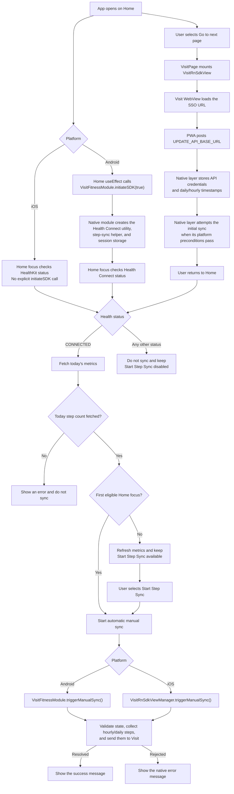

## PMLI SDK `7.1.0`

Install the release with `npm install react-native-visit-rn-sdk@7.1.0`.

When upgrading from `7.0.0`, rename the `magicLink` prop to `ssoURL` and pass the
SSO URL issued for the current session. Remove the legacy URL-generation props.
Remove `react-native-device-info` from the host app if the Visit SDK was its only consumer.

### **Instructions for configuring your Android Project**

* Install the host app dependencies used by the Visit SDK.
  `npm install https://github.com/sashko9807/react-native-location-enabler`  
  `npm install react-native-event-listeners`   
  `npm install react-native-webview`
* Add `https://jitpack.io` to the host app’s Gradle repositories for `com.github.VisitApp:AndroidSDK`.
* Enable code desugaring in your app, or there add the dependency. 

```
coreLibraryDesugaring 'com.android.tools:desugar_jdk_libs:2.1.5'
```

* Inside the `:app` `build.gradle` android block specify these. 

```

android {
	compileOptions {
		coreLibraryDesugaringEnabled true
        sourceCompatibility JavaVersion.VERSION_17
		targetCompatibility JavaVersion.VERSION_17
	}    
}
```

* In the `AndroidManifest.xml` file, add the metadata tag to serve the privacy manifest URL

    ```
     <meta-data
                android:name="visit_android_sdk.health_connect_privacy_policy_url"
                android:value="https://www.google.com" />
    ```
* Version Requirement:  
  AGP: `8.13.2` or higher  
  Kotlin: `1.9.25`or higher  
  `compileSdkVersion`: 36 or higher  

‌

### **Instructions for configuring Plugin in iOS project** 

* Run `npx pod-install` after installing the SDK.
* Install pods(for M1 processors running build on `x86_64` hardware)

    `arch -x86_64 pod install`


* In the Signing & Capabilities section in Xcode, add HealthKit as a capability
* Add this read-only HealthKit key inside the `Info.plist` file. Use it to explain why the app reads steps, calories, distance, and sleep from HealthKit.

```
<key>NSHealthShareUsageDescription</key>
<string>Visit requires your permission to read health and fitness data.</string>
```

## SDK usage

The SDK accepts `ssoURL`, a required string containing the SSO URL supplied
at runtime, and `isLoggingEnabled`, an optional boolean that defaults to `false`.
The component renders without a WebView until it receives a nonblank URL.
Install `react-native-event-listeners` and `react-native-webview` for both
platforms and `react-native-location-enabler` for Android. The Android and iOS
native setup above still applies.

```jsx
import React from 'react';
import VisitRnSdkView from 'react-native-visit-rn-sdk';
import {View} from 'react-native';

export default function VisitScreen({sessionSsoUrl}) {
  return (
    <View style={{flex: 1}}>
      <VisitRnSdkView
        ssoURL={sessionSsoUrl}
        isLoggingEnabled={false}
      />
    </View>
  );
}
```

See the [example app](example/App.js) for connection status and manual sync usage.

## **Example App SDK Initialization and Manual Step Sync**

The example app separates health SDK setup, WebView-driven sync setup, and the
sync request itself. On the first eligible `Home` focus, it automatically
checks the platform connection, fetches today's metrics, and starts manual
sync only if the step read succeeds. The button remains available for later
manual retries.



### **1. Home Mount and Health Status**

On Android, the `Home` component's mount effect calls
`NativeModules.VisitFitnessModule.initiateSDK(true)`. The native method uses
the current Activity to create `HealthConnectUtil`, `VisitStepSyncHelper`, and
`VisitSessionStorage`. `App.js` then immediately sets
`isAndroidSDKInitialized` to `true`; `initiateSDK` is a void bridge call, so
this React state does not confirm that native initialization succeeded. If
`currentActivity` is `null`, the native method skips initialization. Mounting
`VisitRnSdkView` on Android calls `initiateSDK` again, which gives the SDK
another opportunity to initialize with an available Activity.

Once the Android React flag is true and `Home` is focused,
`runHealthStatusFlow()` calls `getHealthConnectStatus()`. On iOS, there is no
equivalent `initiateSDK` call in `App.js`; each `Home` focus calls
`VisitRnSdkViewManager.getHealthKitConnectStatus()` directly.

For either platform, a `CONNECTED` result triggers
`fetchTodayHealthMetrics()`, which requests today's steps, sleep minutes, and
calories from the platform-native module. The helper reports whether the step
request succeeded. On the first eligible `Home` focus, a successful step read
continues directly into manual sync; a failed step read shows an error and
blocks that automatic attempt. Other connection states do not fetch metrics or
start sync.

An in-memory ref records the first automatic attempt. Later `Home` focuses
refresh connection status and metrics but do not automatically sync again
during the same component lifetime.

### **2. WebView Setup and Initial Sync**

Selecting **Go to next page** navigates to `VisitPage` and mounts
`VisitRnSdkView` with the entered SSO URL. After the Visit PWA loads, it must
post an `UPDATE_API_BASE_URL` message containing `apiBaseUrl`, `authtoken`,
`googleFitLastSync`, and `gfHourlyLastSync`.

The SDK handles that message as follows:

* Android calls `VisitFitnessModule.updateApiBaseUrl()`, which stores the
  values in `VisitSessionStorage` and starts the initial sync once per native
  module lifecycle, unless a sync is already running. A failed initial sync
  can be attempted again when the values are updated later.
* iOS calls `VisitRnSdkViewManager.updateApiUrl()` once per mounted
  `VisitRnSdkView`, stores the available non-empty credentials and positive
  timestamps in `NSUserDefaults`, and attempts the initial sync when HealthKit
  is available, credentials are present, permission is available, and no
  other sync is running.

The initial sync and the manual sync share the same native in-progress guard.
Returning to `Home` while the initial sync is still running can therefore make
an explicit button attempt reject with `SYNC_IN_PROGRESS`.

> **Ordering requirement:** `CONNECTED` only represents Health Connect or
> HealthKit access. It does not mean that the Visit API credentials and sync
> timestamps are ready. On a fresh install or after clearing app data, mount
> `VisitRnSdkView` and allow it to process `UPDATE_API_BASE_URL` before either
> automatic or button-driven sync. Otherwise, sync can reject with
> `MISSING_SYNC_CREDENTIALS` or `MISSING_SYNC_TIMESTAMPS` even though health
> access is connected. The automatic attempt runs only once per `Home` mount,
> so after visiting `VisitPage`, use **Start Step Sync** to retry.

### **3. Automatic and Button-Driven Step Sync**

The first eligible `Home` focus uses a shared in-flight lock while it checks
the connection and fetches today's metrics. This disables **Start Step Sync**
during preparation and prevents the button from overlapping the automatic
request. A successful step read calls the shared native sync executor.

The button remains enabled when the health connection status is `CONNECTED`
and no sync flow is running. Automatic and button-driven requests both:

1. Set `syncStatus` to `syncing` and show **Syncing in progress...**.
2. Call `VisitFitnessModule.triggerManualSync()` on Android or
   `VisitRnSdkViewManager.triggerManualSync()` on iOS.
3. Let the native module validate its prerequisites and then collect and
   upload the hourly and daily step data using the stored timestamps,
   credentials, and Visit endpoints.
4. On resolution, set the status to `success` and show **Syncing has been
   done successfully**. On rejection, set the status to `error` and show
   the native error message.

The resolved native status string is written to the console, but the example
shows its own fixed success message. A completed manual sync also does not
automatically reload the three metric cards; those are refreshed the next
time the focused-screen status flow calls `fetchTodayHealthMetrics()`.

### **Manual Sync Preflight and Failures**

| Platform | Code | When it occurs |
| --- | --- | --- |
| Android | `SDK_NOT_INITIALIZED` | Session storage, the Health Connect utility, or the step-sync helper was not initialized. |
| iOS | `HEALTH_DATA_UNAVAILABLE` | HealthKit is unavailable on the device. |
| Both | `SYNC_IN_PROGRESS` | The initial WebView-driven sync or another manual sync is still running. |
| Both | `MISSING_SYNC_CREDENTIALS` | The WebView has not stored a non-empty Visit API base URL and auth token. |
| Android | `MISSING_SYNC_TIMESTAMPS` | Either the stored daily or hourly timestamp is negative. |
| iOS | `MISSING_SYNC_TIMESTAMPS` | Both stored timestamps are zero or missing. |
| iOS | `PERMISSION_DENIED` | HealthKit access is not available when the manual sync starts. |
| Both | `SYNC_FAILED` | The native sync pipeline reports a failure; on iOS this contains the first network or non-2xx Visit response. |

After the preflight passes, Android delegates the hourly and daily work to
`VisitStepSyncHelper`. iOS runs both flows through its shared sync executor.
The iOS executor posts hourly batches to `/users/embellish-sync` and daily
data to `/users/data-sync`; the manual promise resolves only after both flows
finish.

## Fitness data and Health Connect connection

The SDK reads steps, calories, distance, and sleep from Health Connect on Android
and HealthKit on iOS. Android also reads exercise duration for activity totals.
Health Connect history access is optional. The iOS host app needs the HealthKit
capability and an `NSHealthShareUsageDescription` that explains the four metrics.

For Android, declare steps, distance, total calories, sleep, exercise, and optional
history access in the host app's Google Play Health Apps form. Use the merged
manifest to verify the permission list. See [Google Play's Health Connect publishing guide](https://developer.android.com/health-and-fitness/health-connect/publish).

To start the Android connection flow, send:

```javascript
window.ReactNativeWebView.postMessage(
  JSON.stringify({ method: 'CONNECT_TO_GOOGLE_FIT' })
);
```

The native SDK requests Health Connect permissions or opens its Play Store page
if installation or an update is required. Send the same message again after
returning from the store. The PWA can request the current state with
`GET_HEALTH_CONNECT_STATUS`. The native bridge reports `NOT_SUPPORTED`,
`NOT_INSTALLED`, `INSTALLED`, or `CONNECTED`.

Both platforms accept `GET_DATA_TO_GENERATE_GRAPH` for steps, calories, and
distance by day, week, and month, and for sleep by day and week. The SDK
delivers the existing `DetailedGraph` callbacks and supplies steps and sleep
minutes to `updateFitnessPermissions` on connection.

### **7.1.0**

* Accept the host app's SSO URL through the `ssoURL` prop and default `isLoggingEnabled` to `false`.
* Remove the legacy SSO-generation props and the DeviceInfo and Axios dependencies.

### **7.0.0**

* Restore steps, calories, distance, and sleep on Android and iOS.
* Use AndroidSDK `v7.0.0` and start the native Health Connect permission flow directly.
* Remove the Android PWA disclaimer callback.

### **3.0.15**

* Detect when iOS step-read access is unavailable after the HealthKit authorization sheet has already been answered.
* Show recovery instructions when HealthKit access is denied and offer to open the Health settings page.
* Refresh the PWA's HealthKit permission state when the iOS app returns to the foreground.

### **3.0.14**

* Request read-only HealthKit access for step data on iOS without requesting write permission.
* Determine HealthKit connection status without writing and deleting a probe step sample.
* Keep the existing JavaScript APIs and callback signatures unchanged.

### **3.0.13**

* Add iOS compatibility methods for `getTodaySleepMinutes()` and `getTodayCalorieCount()` that resolve to `0`.
* Keep the existing JavaScript APIs and callback signatures unchanged.

### **3.0.12**

* Rely on the PWA's `GET_HEALTH_CONNECT_STATUS` request instead of automatically refreshing Health Connect status whenever the Android app returns to the foreground.

### **3.0.11**

* Upgrade AndroidSDK to `v3.13`.
* Reconcile hourly step buckets with Health Connect's exact daily aggregate so the graph total matches the daily total despite hourly fractional-step truncation.
* Keep the existing React Native APIs and PWA callback signatures unchanged.

### **3.0.10**

* Upgrade AndroidSDK to `v3.12`.
* Keep the existing React Native APIs and PWA callbacks unchanged while Android returns compatibility zero values for removed calorie, distance, and sleep Health Connect data.

### **3.0.9**

* Check Health Connect installation status before native step capability.
* Route `NOT_INSTALLED` directly to the native install/permission flow instead of the PWA disclaimer.
* Route Health Connect status-check failures to the permission flow.
* Keep capability-check failures on the PWA disclaimer fallback.

### **3.0.8**

* Remove duplicate-request suppression so the PWA can restart the flow after the user returns from the Health Connect Play Store page.

### **3.0.7**

* Add Android native step-tracking capability detection through AndroidSDK `v3.11`.
* Add the `window.showHealthConnectDisclaimer()` PWA callback and strict `disclaimerAccepted: true` continuation contract.
* Add Health Connect routing logs for supported, unsupported, and failed capability checks.

### **Sample Project**

The [example app](example) uses React Native `0.86.2` and links the SDK from this
checkout. In the `example` directory, run `npm ci`, then start Metro with
`npm start`. For Android, run `npm run android` in another terminal. For iOS, run
`npx pod-install` and then `npm run ios`. Enter an SSO URL in the running example.

**Permission Usage Declaration:**

1\. For android, Google needs the declaration of how you are using the Health Data in your organisation privacy policy webpage.  
 Description for this is present inside this document along with the permission that needs to be added in the Google Play Console  
<custom data-type="smartlink" data-id="id-0">https://docs.google.com/document/d/1QKtC9ofRtrLIroBzW0pG7BrdrpG_KorHbM5Y0zcgGQI/edit?usp=sharing</custom>   
  

2. For iOS, Health and Fitness permission needs to be added in the App Store Connect Dashboard.  

    

       


‌
